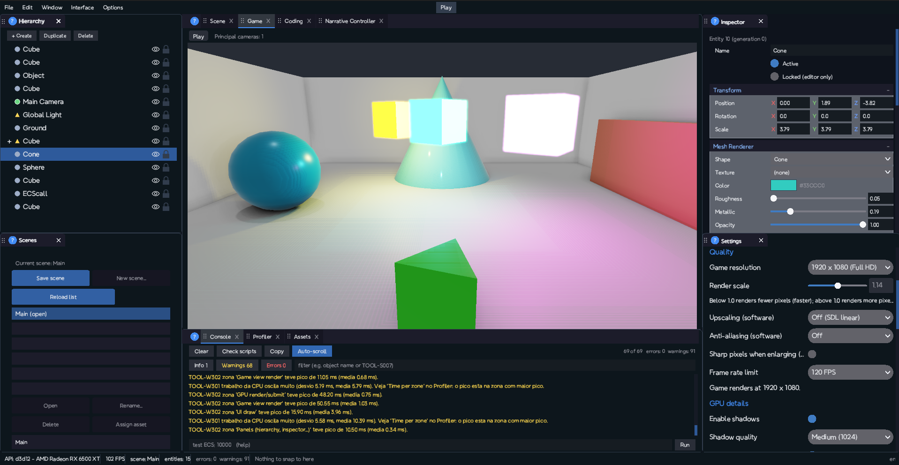
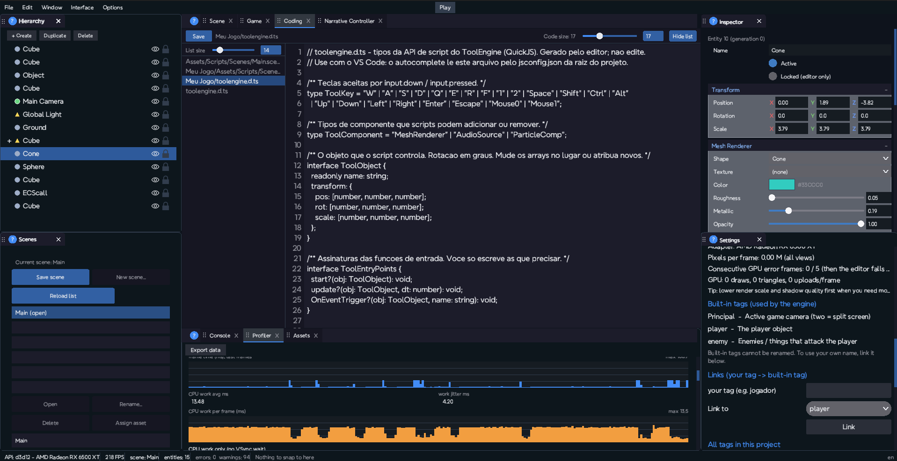
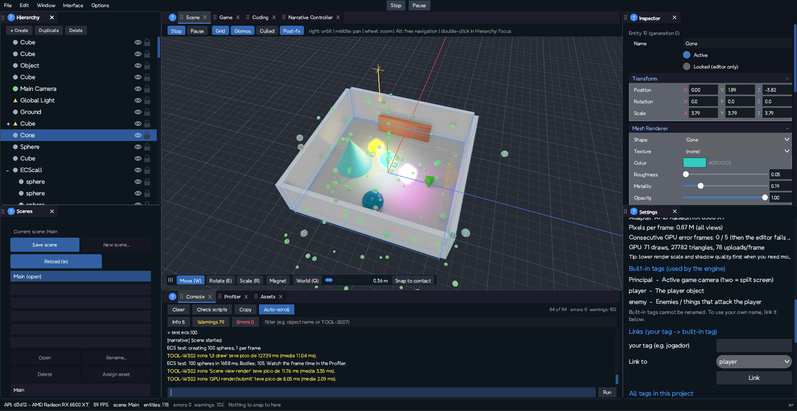
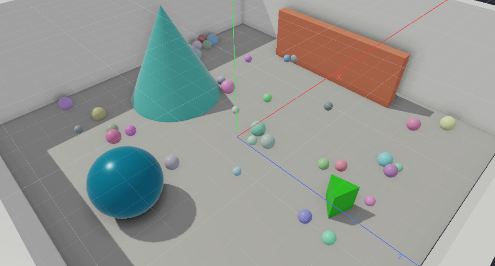

# ToolEngine (nome de trabalho)

Engine 3D leve, multi-API, em C++20, acompanhada de um editor completo desenhado inteiramente com SpriteUI (sem Dear ImGui). A estrutura do repositório foi pensada para o **Visual Studio Code**, e o núcleo e os testes compilam sem dependências externas.

> **Status:** versão 0.9 beta · Autor: João Vitor Dias da Silva

## Capturas de tela


*Modo Play: a vista Game, a Hierarchy, o Inspector e as Configurações (qualidade e GPU) acoplados.*


*Coding: editor de scripts com a lista de arquivos e o tamanho do texto ajustável.*


*Vista Scene com o Play rodando, grade e gizmos, e o Console com os avisos de desempenho.*


*Renderização 3D: centenas de esferas com sombras e iluminação do Light Prism.*

## Pontos fortes

- **ECS com handles de geração:** `engine/core/include/tool/core/handle.hpp` e `engine/ecs`; referências antigas não apontam para objetos reaproveitados.
- **RHI multi-backend:** Vulkan, Direct3D 12, Direct3D 11 e OpenGL, via Diligent (`engine/rhi_diligent`), além de um renderizador por CPU (`SoftRenderer`).
- **Editor 100% em SpriteUI:** inclusive a tela inicial de criar/abrir projeto.
- **Pool de threads persistente:** `parallelFor` reaproveita as threads entre chamadas, sem criá-las a cada quadro.
- **Física Newtoon:** solver paralelo por *graph coloring*, colisão convexa (cascos, cilindros, LOD de colisão por distância), raycast 3D e 2D por BVH e CCD por raio (`engine/physics`, `docs/planos/20`, `22`).
- **ECS:** entidades com geração, consultas, simulação por distância e versão por componente para o cache de matrizes (`docs/planos/19`, `29`).
- **Render com culling em GPU e FSR 1.0:** culling por computes, sombras, SSAO, bloom e upscale FSR 1.0 (FSR 4 em teste de suporte).
- **Partículas v2:** biblioteca em `engine/particles` com formas de emissão, turbulência, empuxo e presets (smoke, fire, fluid), e objeto "Particles" no editor (`docs/planos/28`, `30`).
- **Light Prism:** sistema de luzes da engine (`engine/render`, estudo em `docs/estudos/LIGHT_PRISM.md`).
- **Materiais e Canvas:** materiais por objeto (cor, rugosidade, metálico, emissão, opacidade, neblina) e UI de jogo com Canvas.
- **Suítes de testes:** `tests/` (núcleo) e `apps/editor/tests/` (editor), mais fuzzers em `fuzz/`.

## Pontos fracos

- 1 milhão de objetos ainda não é possível na GPU: estoura o heap dinâmico do Vulkan.
- O sistema antigo de partículas (`ParticleComp`) ainda convive com o v2; a remoção está prevista (F5 do plano 0.9).
- O passe de partículas v2 não existe em OpenGL.
- Ainda não há cena 2D.
- Ainda não há sistema de assets de material e shader.
- A fonte é fixa: apenas uma fonte disponível.
- O occlusion culling da vista Scene roda na CPU (a versão em GPU está em desenvolvimento).
- 1 milhão de objetos ainda não é possível: a medição de 100 mil objetos em movimento deu 221 ms por quadro (`docs/planos/19`).
- Alguns painéis ainda estão em revisão.
- O Windows é a plataforma mais testada.

## Feito e falta fazer

**Feito recentemente**
- Barras de rolagem padronizadas.
- Agrupamento de janelas soltando sobre a aba, o título ou o centro.
- Cores que respeitam o tema.
- Tamanho de fonte digitado livremente.
- Popup de cor com alpha nas Configurações.
- Pool de threads 5x mais rápido na física.
- CPU do editor parado reduzida de 27% para menos de 1%.

**Feito na versão 0.9** (detalhes em [`CHANGELOG.md`](docs/referencia/CHANGELOG.md))
- Colisão convexa e LOD de colisão; cilindro; raycast único com BVH (3D e 2D).
- Cache de matrizes com versão por API; tempo de GPU por passe (`TOOL_GPU_TIMERS=1`).
- Partículas v2 no editor, com presets e passe de render.
- Canvas substitui o UiCanvas; janelas soltas; seletor de cor compartilhado; Settings por categorias.

**Em desenvolvimento** (fonte: [`35_PLANO_V09.md`](docs/planos/35_PLANO_V09.md))
- Oclusão em GPU (HiZ), com modo CPU só para teste e medição.
- Impostores (atlas por ângulo, billboard e grupo com objeto de referência): [`docs/estudos/IMPOSTORES.md`](docs/estudos/IMPOSTORES.md).
- LODs por objeto e AutoLOD (simplificação de malha e textura).
- Entity Manager, com EntityManagerScript editável na pasta do jogo.
- Ray tracing por GPU (F0 concluída; F1 pendente).
- FSR 4 além do upscale de teste, motion vectors e frame generation.

**Falta fazer** (fonte: [`13_FUNCIONALIDADES_FUTURAS.md`](docs/planos/13_FUNCIONALIDADES_FUTURAS.md))

| Prioridade | Itens |
|---|---|
| P0 | Tamanho de fonte sem teto fixo; escala em todo elemento de Canvas/UI; color picker único com alpha |
| P1 | Fontes do projeto; imagens no Canvas/UI e botão com textura; cena 2D; materiais como assets |
| P2 | Biblioteca de partículas nova; shaders como assets; projeto de exemplo Pong (2D e 3D) |

## Como abrir
1. Instale: VS Code, CMake >= 3.25, um compilador (GCC/Clang/MSVC).
2. `File > Open Folder` nesta pasta. Aceite instalar as extensões recomendadas
   (CMake Tools, clangd, C/C++, clang-format).
3. `Ctrl+Shift+B` configura e compila (preset **dev**). `F5` depura o *sandbox*.
4. Testes: tarefa **test** (ou `ctest --preset dev`). Sanitizers: tarefa **asan**.

## Abrir o editor (caminho direto)
- Windows: dois cliques em `build_editor.bat` (qualquer Visual Studio recente com "Desenvolvimento para desktop com C++"). Linux/macOS: `./build_editor.sh`.
- O editor inteiro é desenhado com SpriteUI (sem Dear ImGui). A tela inicial (criar/abrir projeto) também.
- Sem Git, Ninja ou internet para o build legado (dependências embutidas em `third_party/`). O painel experimental SpriteUI é habilitado por padrão e é obtido pelo CMake; para build offline, configure com `-DTOOL_WITH_SPRITEUI=OFF`. Passo a passo: `COMO_COMPILAR.txt` / `HOW_TO_BUILD.txt`.
- Build com GPU: `build_editor.bat gpu` (Windows) ou `./build_editor.sh --gpu` (Linux); precisa clonar `third_party/DiligentCore` (veja `HOW_TO_BUILD.txt`); a primeira vez leva ~12 min.

## Linha de comando (núcleo e testes)
```
cmake --preset dev && cmake --build --preset dev
ctest --preset dev
```
Presets: `editor` (só o editor, CPU), `editor-gpu` (+Vulkan/OpenGL), `editor-gpu-dx11` (Windows + D3D11), `dev`, `test`, `release`, `asan`, `beta`.

## Estrutura
```
engine/core     tipos, handles com geração, tags internadas, log
engine/debug    DebugTool: diagnósticos TOOL-Exxx/Wxxx, zonas, orçamentos, watchdog
engine/ecs      ECS embutido (esparso/denso), tags, consultas
engine/events   EventBus + EventArbiter (exclusão mútua, one-shot, cooldown, ciclos)
engine/scene    Scene, ToolObject, Blueprint, DeleteAndReuse (pool)
engine/input, platform, audio   entrada/gamepad, janela, mixer de áudio
engine/math, rhi, render        matemática, interface de GPU, iluminação, SoftRenderer (CPU)
engine/narrative, mod, net, pack   Controlador Narrativo, ModTool, NetTool, pacotes .tpak
apps/editor     editor (SpriteUI, preset editor)   fuzz/  fuzzers   tools/  compilador de shaders   assets/shaders/hlsl e glsl
apps/sandbox    jogo de teste
tests           testes automatizados (sem dependências)
docs/           planos, estudos e referência
```
Dependências apontam sempre para baixo: scene → events/ecs → debug → core.

## Documentação

- [`docs/planos/13_FUNCIONALIDADES_FUTURAS.md`](docs/planos/13_FUNCIONALIDADES_FUTURAS.md): funcionalidades pedidas, com prioridades.
- [`docs/estudos/RENDER_MILHOES.md`](docs/estudos/RENDER_MILHOES.md): caminho para renderizar milhões de objetos.
- [`docs/estudos/FISICA_OTIMIZACAO.md`](docs/estudos/FISICA_OTIMIZACAO.md): otimização da física.
- [`docs/planos/14_LIMPEZA_DO_REPOSITORIO.md`](docs/planos/14_LIMPEZA_DO_REPOSITORIO.md): limpeza do repositório.
- [`COMO_COMPILAR.txt`](COMO_COMPILAR.txt) / [`HOW_TO_BUILD.txt`](HOW_TO_BUILD.txt): passo a passo de compilação.
- [`docs/referencia/CHANGELOG.md`](docs/referencia/CHANGELOG.md): histórico de mudanças.
- [`docs/planos/00_ROADMAP.md`](docs/planos/00_ROADMAP.md): ordem recomendada de implementação.
