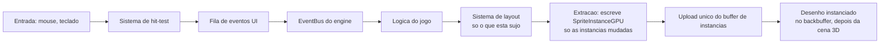
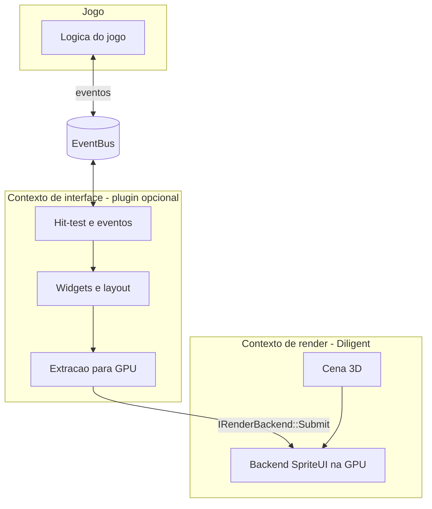
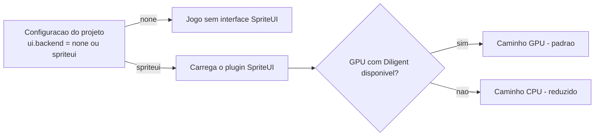
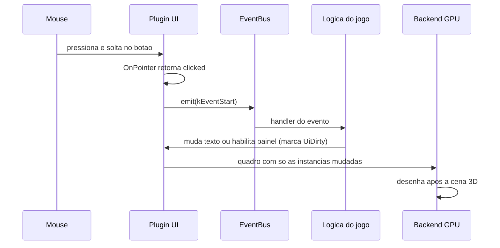

# Analise: interface do jogo com SpriteUI na GPU

Status: analise e plano. Nada disto esta implementado no jogo ainda. Os numeros de custo sao estimativas
a partir do tamanho das estruturas (medicao no seu computador vem na etapa 1).

## 1. Estado atual (fatos do codigo)

| Parte | Como desenha hoje | Onde |
|---|---|---|
| Interface do editor | SpriteUI gera a geometria na CPU; `SDL_RenderGeometry` desenha no driver do SDL (GPU quando ha driver) | `apps/editor/spriteui_host.hpp`, `main.cpp` (`createEditorRenderer`) |
| Cena e Jogo no editor | Diligent (ou rasterizador de CPU) renderiza, copia da GPU para a CPU (readback) e envia a textura ao SDL a cada quadro | `apps/editor/editor_state.hpp` (`readbackAsync`), `main.cpp` (`SDL_UpdateTexture`) |
| Adapter GPU do SpriteUI | Ja esta no `third_party` vendorizado (`adapters/toolengine`), identico ao do repositorio do SpriteUI (`b9bef4a`). Shaders em `assets/shaders` tambem identicos | `third_party/SpriteUi/adapters/toolengine/include/SpriteUi/Adapters/ToolEngineRhi.hpp` |
| Jogo (runtime) | Nao usa SpriteUI. Nao ha plugin de interface | - |
| Plugins | A engine nao tem sistema de plugins; so existe `mod` (ModTool) | `engine/mod` |
| Eventos | Barramento `tool::EventBus` com `subscribe`/`emit` e arbitro (`EventArbiter`) | `engine/events` |

## 2. Gargalos, por ordem de impacto

1. **Readback por quadro (editor).** A imagem da Cena e do Jogo sai da GPU, vai para a CPU e volta para uma
   textura do SDL. Isso e o maior custo do editor. No jogo final nao existe: o quadro vai direto para o
   swap-chain. Por isso o jogo nao herda esse gargalo, mas a interface do editor precisa dele separado.
2. **Expansao de vertices na CPU (adapter).** `BuildVertices` transforma cada instancia (80 bytes) em quatro
   vertices de 52 bytes: 208 bytes por quad, cerca de 2,6 vezes a banda da instancia. Tudo e reenviado a cada
   quadro com `updateBuffer`, mesmo quando nada mudou.
3. **Montagem do quadro inteiro na CPU (SpriteUI).** Layout, hit-test e geracao de `FramePacket` acontecem
   a cada quadro para todos os elementos, inclusive os parados.
4. **Eventos com `std::function` e `std::any`.** Cada evento aloca. Aceitavel para clique, ruim se usado
   dentro de laço por quadro (por exemplo, um evento por instancia).
5. **Texto.** O atlas de glifos sobe uma vez (bom). A layout de texto tem cache. Nao e gargalo hoje.

## 3. Arquitetura alvo

### 3.1 Dados (ECS)

Componentes da interface, guardados como arrays (SoA), nao como objetos com metodos virtuais por quadro:

- `UiRect` (posicao, tamanho, ancora, pai)
- `UiStyle` (cores, raio, fonte)
- `UiText` (texto, cache de layout)
- `UiInteractable` (estado: sob o ponteiro, pressionado, habilitado)
- `UiBinding` (numero do evento disparado no clique)
- `UiDirty` (marca o que mudou desde o ultimo quadro)

### 3.2 Sistemas (um fluxo por quadro)

### 3.3 Por que e mais rapido

- **Instancias em vez de vertices.** O formato `SpriteInstanceGPU` (80 bytes) ja existe no SpriteUI e foi
  pensado para isso. Um quad fixo e expandido pelo vertex shader. Some o `BuildVertices` e cai a banda de
  208 para 80 bytes por quad (2,6 vezes menos).
- **Upload parcial.** Com `UiDirty`, so as instancias mudadas sao reescritas. Interface parada custa quase zero.
- **Sem readback.** A UI do jogo desenha no mesmo alvo da cena, depois dela, sem copiar nada para a CPU.
- **Eventos como dados.** A fila de eventos guarda numeros e payloads simples; o `EventBus` so recebe o
  evento ja decidido, uma vez por clique.

### 3.4 Limites entre modulos (DDD: contextos e portas)

- A **UI nao conhece** a cena nem o Diligent: fala com o render por `IRenderBackend` (porta que ja existe).
- O **jogo nao conhece** os widgets: fala por eventos (`EventBus`).
- A **UI e um plugin**: a engine so chama `IUiPlugin` (carregar, quadro, desenhar, descarregar).

### 3.5 Plugin e escolha do usuario

- Primeira versao: plugin **estatico**, ligado por opcao de CMake (`TOOL_GAME_SPRITEUI`). Sem DLL dinamica.
- Se o jogo escolher `none`, a biblioteca SpriteUI nem entra no executavel.

## 4. Fluxo de um clique (sequencia)

## 5. Plano em etapas (com criterio de aceite)

| Etapa | Entrega | Criterio de aceite |
|---|---|---|
| 1. Medicao | Tempo por quadro do editor com 0, 200 e 1000 botoes, UI parada e UI mudando | Tabela com ms por quadro e por driver (OpenGL, D3D11) no seu computador |
| 2. Adapter | Ja vendorizado (nada a fazer). Validar o `spriteui_gpu_test` com GPU ou Xvfb | Teste GPU passa com OpenGL e Vulkan |
| 3. Instancias | Trocar `BuildVertices` por desenho instanciado com `SpriteInstanceGPU` | Pixels iguais aos do teste GPU; banda cai ~2,6x |
| 4. Dirty | Upload so das instancias mudadas | UI parada custa menos de 0,1 ms por quadro com 1000 botoes |
| 5. Plugin | `IUiPlugin`, escolha em `ui.backend`, opcao de CMake | Jogo compila com e sem a UI; `none` nao linka SpriteUI |
| 6. Eventos | Fila de eventos UI, sem alocacao por evento | Nenhuma alocacao por clique medida |

## 6. Riscos

- O shader instanciado precisa ser escrito de novo (GLSL 430 e HLSL). Teste de pixel obrigatorio.
- Diligent GL e Vulkan podem se comportar diferente no alvo do backbuffer: a etapa 3 precisa de teste nos dois.
- A UI do editor continua no renderizador SDL. Isso e separado de proposito.

## 7. Decisoes que preciso de voce

1. Aprova a etapa 1 (medicao) antes de mexer no adapter?
2. O plugin comeca estatico (sem DLL)? Recomendo sim.
3. (Resolvido) O adapter e os shaders ja estao no projeto; nada a copiar.
