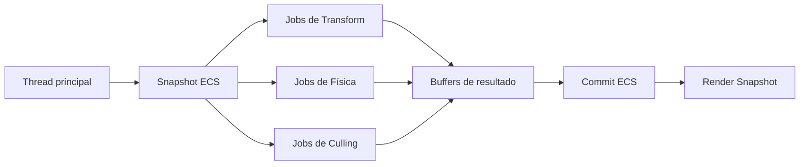

## Diagnóstico

O profiler confirma que o problema principal não é quantidade de draw calls nem falta de potência da GPU. O gargalo está principalmente na preparação da cena e na física executadas de forma síncrona na thread principal.

Fonte: `ProfilerExport_20261123_021344_777.md`

### Métricas principais

| Área | Tempo médio |
|---|---:|
| CPU total por frame | **169–174 ms** |
| FPS | **6 FPS** |
| Scene preparation | **102–104 ms** |
| Physics simulation | **35–38 ms** |
| Update geral | **37–40 ms** |
| UI ImGui | 6 ms |
| GPU render/submit | 17–18 ms |
| Draw calls | 17 |
| Objetos vivos | 5007 |
| Objetos desenhados | 5002 |
| Triângulos GPU | aproximadamente 3 milhões |
| Pico de frame | 1140 ms |

O objetivo de 60 FPS exige aproximadamente **16,67 ms por frame**. Atualmente o frame principal usa cerca de **170 ms**, portanto seria necessário reduzir aproximadamente 90% do custo de CPU para atingir 60 FPS nesse cenário.

---

## Gargalo principal: preparação da cena

A preparação usa `Editor::renderScene`.

O profiler mostra:

- `Scene preparation`: aproximadamente **102 ms**
- Apenas cerca de **1042 objetos** aparecem nos passes normais.
- Porém, os **5002 objetos continuam sendo considerados shadow casters**.
- `culled: 0`
- CSM com 3 cascatas.
- Cerca de 1,9 milhão de triângulos processados apenas nas sombras.

O código atualmente desativa o culling para objetos que projetam sombras:

```cpp
if (!(doCull || occ.active()) ||
    ((shadows || !lf.shadowLights.empty()) && mr.castShadow))
    return false;
```

Isso faz com que praticamente todos os objetos sejam processados para sombras, mesmo quando estão:

- fora da câmera;
- muito distantes;
- fora da área útil das cascatas;
- completamente fora do `shadowDistance`.

### Correções prioritárias

1. **Culling independente para cada cascata de sombra**
   - Cada cascata deve ter seu próprio frustum.
   - Um objeto deve ser incluído somente nas cascatas cujo volume contenha seu bounding sphere.
   - Não usar mais “todo objeto com `castShadow` sempre passa”.

2. **Aplicar `shadowDistance`**
   - O objeto não deve entrar na lista de sombras quando estiver além da distância máxima.
   - Atualmente o valor existe em `lighting.hpp`, mas o caminho de preparação ainda precisa usá-lo agressivamente.

3. **Separar objetos estáticos e dinâmicos**
   - Shadow map de objetos estáticos pode ser reutilizado.
   - Objetos dinâmicos devem atualizar somente cascatas afetadas.
   - O cenário estático não deve ser reprocessado a cada frame.

4. **Cachear transformações mundiais**
   - `worldMat(e)` é chamado repetidamente por:
     - culling;
     - shadow signature;
     - render normal;
     - LOD;
     - oclusão;
     - RT AO.
   - Para 5000 entidades, isso representa várias passagens recursivas pela hierarquia.
   - Criar uma etapa de atualização de transformações que produza um array contíguo por entidade e reutilizá-lo durante o frame.

5. **Cachear dados de renderização por entidade**
   - Malha selecionada;
   - material;
   - bounding sphere;
   - flags de sombra;
   - matriz mundial;
   - nível de detalhe.

A preparação deveria gerar um `RenderSnapshot` uma vez e os passes deveriam somente consumi-lo.

---

## Gargalo secundário: física

A física consome aproximadamente **35–38 ms por frame**, equivalente a mais de duas vezes o orçamento total de um frame de 60 FPS.

A física já possui um pool persistente em `newtoon_jobs.hpp` e usa paralelismo em algumas fases de `newtoon_world.hpp`.

Entretanto, grande parte do fluxo ainda é serial:

- reconstrução da BVH;
- consulta dos pares;
- narrow phase;
- solver;
- eventos de colisão;
- sincronização dos transforms;
- sleep;
- criação de eventos `Enter/Stay/Exit`.

Além disso, o teste ECS cria 5000 corpos dinâmicos e todos começam ativos:

```cpp
PhysicsComp ph;
ph.collider = 2;
ph.mass = 1.f;
```

O teste força a física a processar milhares de esferas simultaneamente.

### Melhorias na física

1. **Não reconstruir a BVH completa a cada passo**
   - `PhysicsWorld::Step` chama `Prepare`.
   - `Prepare` recalcula todas as formas e executa `bvh_.Build`.
   - Usar BVH dinâmica ou refit incremental:
     - atualizar somente AABBs modificados;
     - reconstruir a árvore apenas quando necessário;
     - reconstruir em lotes.

2. **Usar broad phase por células espaciais**
   - Para milhares de esferas, uma uniform grid ou sweep-and-prune pode ser mais barata que reconstruir uma BVH inteira.
   - Objetos distantes podem ser colocados em regiões separadas.
   - A colisão deve ocorrer apenas entre células vizinhas.

3. **Parallelizar a geração de pares**
   - Atualmente a busca de pares é serial:

   ```cpp
   for (size_t i = 0; i < n; ++i) {
       bvh_.Query(...);
       pairs_.push_back(...);
   }
   ```

   - Usar buffers de pares por worker e fazer uma concatenação ao final.
   - Evitar `push_back` concorrente em um vetor global.

4. **Parallelizar narrow phase**
   - Cada par pode produzir contatos em um buffer local por thread.
   - Depois, juntar os contatos.
   - A parte de detecção é naturalmente paralelizável.

5. **Solver por ilhas de contato**
   - Separar corpos conectados por contatos em ilhas independentes.
   - Resolver ilhas em paralelo.
   - Ilhas pequenas podem continuar na thread principal para evitar overhead.

6. **Diminuir o custo de synchronização ECS**
   - Atualmente a física copia todos os corpos dinâmicos de volta para o ECS:

   ```cpp
   for (size_t i = 0; i < play.ents.size(); ++i) {
       ...
       t->pos[0] = play.tf[i].position.x;
   }
   ```

   - Atualizar somente corpos que realmente se moveram.
   - Usar uma lista `dirtyBodies`.
   - Evitar converter quaternion para Euler quando a rotação não mudou.

7. **Reduzir frequência da física**
   - Corpos distantes podem simular em 30 Hz ou 15 Hz.
   - Corpos fora da câmera podem usar atualização desacelerada.
   - Objetos sem interação podem ser colocados imediatamente em sleep.

---

## O ECS possui multithread?

Existe suporte parcial:

- `World::parallelEach`
- `tool::parallelFor`
- Pool persistente de até 8 threads.
- JobSystem separado para a física.

Porém, o caminho principal do editor ainda usa várias chamadas sequenciais:

```cpp
scene.world().each<MeshRenderer, Transform>(...)
scene.world().each<PhysicsComp>(...)
scene.world().each<ToolsComp, Transform>(...)
```

O teste ECS também cria entidades na thread principal em `ecs_test.hpp`.

### Não é seguro simplesmente trocar tudo por `parallelEach`

O callback paralelo não pode:

- criar ou remover componentes;
- destruir entidades;
- modificar estruturas compartilhadas;
- adicionar eventos diretamente em vetores globais;
- acessar APIs que não são thread-safe.

O caminho recomendado é usar:

1. **Snapshot imutável de leitura**
2. **Jobs paralelos**
3. **Command buffer por thread**
4. **Commit das alterações na thread principal**

Exemplo de arquitetura:



---

## Async não deve ser a primeira solução

A física e o culling podem ser executados de forma assíncrona, mas isso exige uma arquitetura de frames:

- frame N renderiza;
- frame N+1 prepara física e culling;
- resultados são publicados por double buffering;
- somente dados imutáveis são lidos pelo renderer.

Não é recomendável colocar `std::async` diretamente no loop atual, porque:

- cria overhead;
- aumenta a latência;
- pode gerar data races;
- a renderização ainda precisa esperar o resultado;
- o ganho será pequeno se os trabalhos forem imediatamente aguardados.

O pool persistente atual é uma base melhor que `std::async`.

---

## Ordem recomendada de implementação

### Fase 1 — maior retorno

1. Culling por cascata de sombra.
2. Aplicar `shadowDistance`.
3. Desabilitar sombras dos objetos do teste ECS ou limitar a um subconjunto.
4. Cache de matrizes mundiais por frame.
5. Cache de seleção de mesh, bounds e material.

Essa fase provavelmente reduzirá drasticamente os **102 ms de Scene preparation**.

### Fase 2 — física

1. Refit incremental da BVH.
2. Pair generation paralelo.
3. Narrow phase paralelo.
4. Solver por ilhas.
5. Atualização somente de corpos dirty.
6. Sleep agressivo para corpos estáveis.

### Fase 3 — ECS/job system

1. Criar `CommandBuffer`.
2. Criar snapshots imutáveis.
3. Adicionar sistemas paralelos:
   - `TransformSystem`;
   - `CullingSystem`;
   - `PhysicsSyncSystem`;
   - `AnimationSystem`.
4. Separar fases de leitura e escrita.
5. Adicionar double buffering para render snapshot e física.

### Fase 4 — renderização

1. Instancing por mesh/material.
2. LOD mais agressivo.
3. Occlusion culling com cache.
4. Atualização seletiva de shadow maps.
5. GPU timestamp queries para separar custo real da GPU e custo de submit.

---

## Conclusão

O maior problema atual é:

1. **Preparação de cena serial e repetitiva — 102 ms**
2. **Física com BVH reconstruída e etapas seriais — 35–38 ms**
3. **Todos os 5002 objetos tratados como shadow casters**
4. **Uso limitado do paralelismo ECS**
5. **Nenhum pipeline de snapshot/command buffer para async seguro**

Os dados não indicam falta de batching: são apenas **17 draw calls**. Também não indicam falta de VRAM: apenas **317 MB usados de 7,3 GB**.

A primeira alteração recomendada é implementar culling por cascata e limitar os shadow casters. Depois, a maior melhoria estrutural será substituir o fluxo atual por snapshots ECS + jobs paralelos + commit controlado.