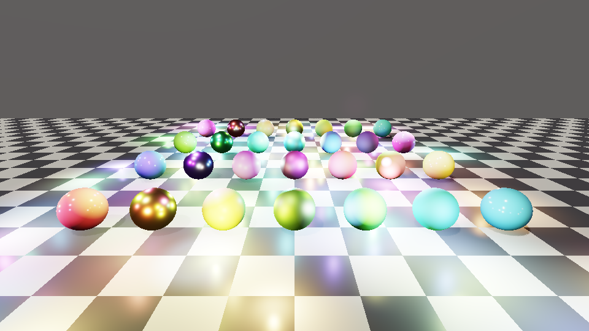
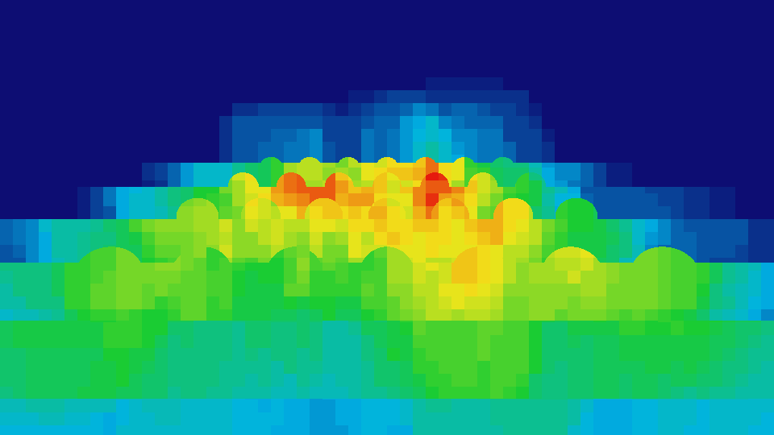
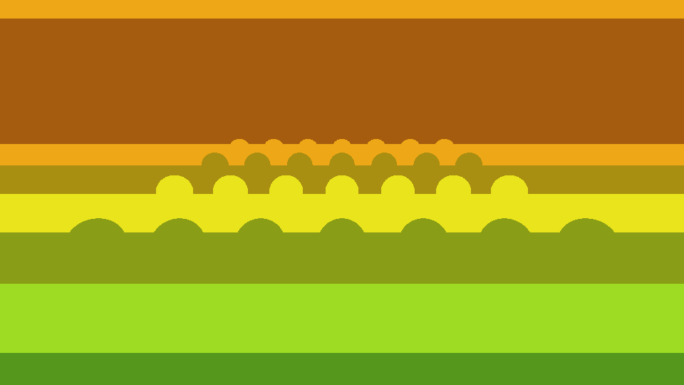

# Fase 2 — Clustered Culling

Divide o frustum da câmera em clusters (tiles de tela × fatias logarítmicas de profundidade) e gera,
para cada cluster, a lista compacta das luzes que o tocam. O pixel shader lê só essa lista.

## Por que não o esquema do documento original

O esquema fixo (64 luzes × clusters) custava ~189 MB em 4K e usava um array local de 256 índices por
thread no compute shader (estouro de registradores). Aqui: contar → prefix sum → preencher. Sem atomics,
sem arrays locais, sem buffer de AABBs (o AABB do cluster é calculado na hora).

| Recurso (1080p, tile 16, 24 fatias = 195.840 clusters) | Tamanho |
|---|---|
| `ClusterCounts` (uint) | 0,75 MiB |
| `LightGrid` (`ClusterCell`, 8 B) | 1,5 MiB |
| `LightIndexList` (8 índices/cluster, ajustável por `maxIndices`) | 6 MiB |
| `GroupSums` + `Stats` | ~3 KiB |
| **Total** | **~8 MiB** |

Em telas maiores que ~1440p, use `SuggestClusterTileSize()` (tile 32 mantém ~200 mil clusters em 4K).

## Ordem dos dispatches (por frame, após `BuildFrame` + `UploadToGPU`)

| # | Shader (entry) | Dispatch | Lê | Escreve |
|---|---|---|---|---|
| 1 | `ClusterLightPrep.compute.hlsl` (CSMain) | ⌈(np+ns)/64⌉ | luzes, view | `ClusterLight[]` |
| 2 | `ClusterCullCount.compute.hlsl` (CSMain) | ⌈clusters/64⌉ | `ClusterLight[]` | `ClusterCounts` |
| 3 | `ClusterScan.compute.hlsl` (ScanLocal) | ⌈clusters/256⌉ | `ClusterCounts` | `ClusterCounts` (offset local), `GroupSums` |
| 4 | `ClusterScan.compute.hlsl` (ScanGroupSums) | 1 | `GroupSums` | `GroupSums` (offset do grupo), `Stats[0]` |
| 5 | `ClusterCullFill.compute.hlsl` (CSMain) | ⌈clusters/64⌉ | tudo acima | `LightIndexList`, `LightGrid` |

Barreira UAV entre cada passo. O `ClusterGridGPU` (cbuffer b0) é o mesmo em todos; `numPointLights` /
`numSpotLights` vêm de `FrameLightView`.

## Prioridade e estouro

- `BuildFrame` ordena as luzes por prioridade decrescente; os passes 2 e 5 percorrem na mesma ordem e
  param ao atingir `maxLightsPerCluster`. Ficam as mais importantes. Pontos vêm antes de spots.
- Se a soma ultrapassar `maxIndices`, os clusters do fim perdem luzes (escrita descartada, nunca
  fora do buffer). Leia `Stats[0]` (de forma assíncrona) e compare com `maxIndices` para detectar.

## Referência CPU e fallback sem compute

`CullLightsCPU` (include/LightPrism/Cluster/ClusterCulling.hpp) executa o mesmo algoritmo e produz os
mesmos buffers (`cells` = `LightGrid`, `indices` = `LightIndexList`). Serve para:

1. validar a matemática (os testes provam que todo ponto dentro do volume de uma luz tem essa luz na
   lista do seu cluster, e que o scan hierárquico bate com um scan sequencial);
2. GPUs/APIs sem compute: suba `cells` e `indices` para os buffers e use o mesmo pixel shader.

Os `.hlsl` espelham o C++ linha a linha. Mudou um, mude o outro.

## Bindings do passe de iluminação (`ClusterLighting.hlsli`)

`b0` globals, `b1` sol, `b5` grid, `t1` pontos, `t2` spots, `t8` `LightGrid`, `t9` `LightIndexList`.

## Limitações conhecidas

- A projeção é tratada como simétrica (`P[0][0]`, `P[1][1]`). Jitter de TAA sub-pixel é ignorado;
  se necessário, aumente a folga de meio pixel em `ComputeClusterRange`.
- O AABB de um tile longe do centro da tela e em fatias profundas é bem maior que a célula real, então
  há falsos positivos (nunca falsos negativos). Refinar com teste contra a pirâmide exata é um
  candidato a otimização, depois de perfilar.
- Luzes inteiras antes de `zNear` ou depois de `zFar` são descartadas.

## ClusterSystem (orquestração)

`ClusterSystem::Execute(device, lights, frame, camera)` faz tudo da tabela acima: recria buffers quando a tela
ou o orçamento mudam, liga os recursos pelo nome (`ClusterGridCB`, `Lights`, `ClusterCounts`, ...), dispara os 5
dispatches com barreiras UAV (8 no total) e copia `Stats` para um buffer de readback.

- **Modo:** `Auto` usa GPU e cai no CPU se o dispositivo não tiver compute ou algum shader falhar ao compilar
  (`FallbackReason()` diz por quê). `Gpu` / `Cpu` forçam o modo. No CPU os mesmos buffers são preenchidos pela
  referência, então o pixel shader não muda.
- **Overflow:** `ReadbackStats()` lê o total de índices pedidos. Chame alguns frames depois do `Execute` (a GPU
  precisa ter terminado a cópia); antes disso retorna `false`.
- **Nomes de binding:** o compilador de shader remove recursos não usados num entry point (ex.: `Stats` no
  `ScanLocal`). O RHI ignora esses nomes em vez de falhar; um teste confere todos os nomes contra os `.hlsl`.
- **Limite de dispatch 1D:** `clusters/64` precisa caber em `maxComputeGroupsPerDim` (65535 → ~4,19 milhões de
  clusters). Acima disso `Execute` falha com mensagem; aumente `tileSizePx` ou reduza `zSlices`.

## Renderizador por software (`lp_softrender`)

Sem GPU nem API gráfica. Raycast analítico (planos e esferas) para um G-buffer, depois iluminação direta com a
BRDF de referência e as listas do culling em clusters. A cena de demonstração tem 120 luzes pontuais, 12 spots
e um sol fraco; o resultado em 960x540:

| | |
|---|---|
|  |  |
| `lit.png`: imagem final (ACES + sRGB) | `heatmap.png`: luzes por cluster (azul = poucas, vermelho = muitas) |
|  |  |
| `slices.png`: fatias de profundidade | `diff_x100.png`: diferença clusters vs todas as luzes, x100 (preto = idêntico) |

Resultado medido (Release, CPU single-thread): clusters usam **8,1%** das avaliações de luz (5,6 M contra
68,4 M), a imagem é **idêntica bit a bit**, e o shading cai de 2310 ms para 213 ms. O sol usa sombras em cascata (veja `SHADOWS.md`).
