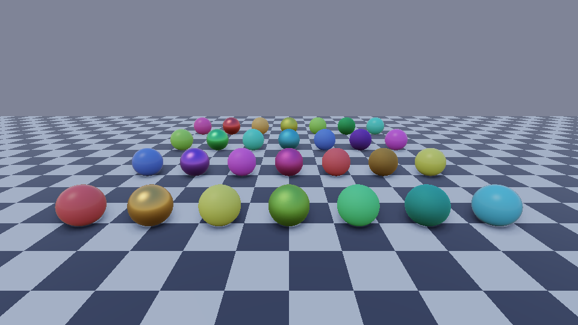
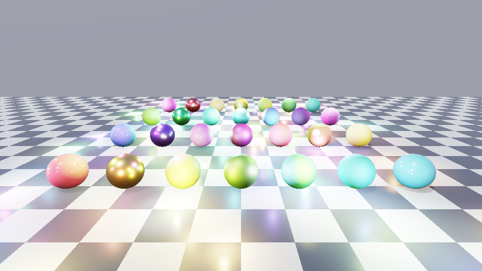
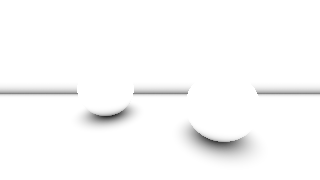
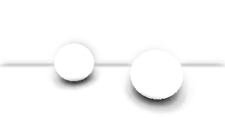

# Fase 4 — IBL e SSAO

Iluminação indireta clássica: **difuso por SH9**, **especular por split-sum** e **SSAO**. Tudo tem referência em C++
(`include/LightPrism/Ibl/Ibl.hpp`, `Post/Ssao.hpp`), espelho em HLSL (`shaders/Common/Ibl.hlsli`,
`shaders/PostProcess/Ssao.compute.hlsl`) e é validado no renderizador por software, sem GPU.

| | |
|---|---|
|  |  |
| `ibl_ambient_only.png`: só IBL + SSAO (sem luzes diretas) | `ibl_full.png`: luzes + sombras + IBL + SSAO |

## IBL

| Parte | O que é | Custo no shader |
|---|---|---|
| Difuso | 9 coeficientes RGB (`IblGPU`, 160 B), já convoluídos com o cosseno e multiplicados pelas constantes da base | polinômio de grau 2, sem textura |
| Especular | cubemap pré-filtrado (mip i = rugosidade i/(mips−1)) + LUT RG da BRDF | 2 leituras de textura |
| Energia | `kD = (1 − (F0·A + B))·(1 − metallic)` em vez de `1 − F(N·V)` do documento: usa a mesma energia que o especular já tirou | — |
| Direção do lobo | `R` é puxado em direção a `N` conforme a rugosidade (Lagarde) | 1 lerp |
| AO | difuso × `ao`; especular × `SpecularOcclusion` (Lagarde) | — |

Pré-computação (CPU, uma vez por ambiente): `BuildIblData(env)`. A engine só sobe `prefiltered.mips[i].face[0..5]`
(RGB32F/RGB16F, ordem D3D +X −X +Y −Y +Z −Z) e `lut.ab` (RG, 32×32 basta), e o cbuffer `MakeIblGPU(...)` (b3).
`EnvFn` é qualquer função direção→radiância; para um skybox real, envolva a amostragem do seu cubemap.
O seu `ibl.intensity` já deve conter a exposição.

Mudanças em relação ao documento original (Seção 24):
- LOD = `roughness·(mips−1)` com mips distribuídos linearmente em rugosidade (o documento fixava 5.0).
- Sem aproximação analítica da LUT: a de Karis foi ajustada para outra BRDF e errou até 0,27 contra a nossa;
  em GPUs fracas use LUT 16×16.

## SSAO

Dois passes (bruto + blur bilateral 4×4), em meia resolução se quiser. Diferenças do esquema do documento:
- sem textura de ruído: padrão de rotação 4×4 fixo (Bayer), cancelado pelo blur de 4×4;
- kernel ponderado por cosseno com distância uniforme: o estimador converge para
  `ao = 1 − média(raio acerta a distância t ? 1 − t/raio : 0)`, que é a referência dos testes;
- `bias = bias + biasPerMeter·profundidade` (o depth buffer fica grosseiro longe; sem isso o piso plano distante se auto-ocluía em até 25%);
- desbota para 1 entre `fadeStart` e `fadeEnd` (20–40 m): SSAO longe é só ruído.
- Profundidade linear = `P23 / (z + P22)` a partir do reverso-Z; normais em view space.

| AO por raios (verdade) | SSAO bruto | SSAO + blur |
|---|---|---|
|  |  |  |

## Como foi validado (`lp_ibl_tests`, `lp_ssao_tests`)

| Verificação | Resultado medido |
|---|---|
| Ambiente constante → irradiância = constante (SH) | erro < 0,002 |
| SH9 vs integral do cosseno, céu procedural, 40 normais | pior erro 4,2% |
| Lobo cosseno em +z (valor analítico 2/3) | 0,661 |
| Constantes empacotadas (CPU) == avaliação por SH | 1e-4 |
| Cubemap: ida e volta direção↔face↔direção | 1e-4 |
| LUT: 256 amostras vs 16384 | erro 0,015 |
| LUT vs integral por força bruta na esfera (F0=0 e 1) | erro 0,0009 |
| LUT 32×32 amostrada vs integração direta | erro 0,014 |
| `A+B ≤ 1` (conservação de energia, sem multiscattering) | ok |
| Pré-filtro: ambiente constante, monotonia do pico do sol, energia média | média 0,4102 → 0,4091 |
| Split-sum + SH vs integral completa da BRDF (24 casos, inclui ângulos até 74°) | pior 12,1% |
| SSAO: piso plano sem auto-oclusão | AO mín. 0,99 |
| SSAO vs AO por raios (pixels ocluídos) | erro médio 0,098, viés 0,006, correlação 0,89 |
| SSAO: raio maior nunca clareia | ok |

**Testes de mutação:** 15 defeitos injetados (banda do SH errada, constante da base, A/B da LUT trocados,
prefiltro sem NoL, face do cubemap espelhada, pack sem constante, difuso sem conservação de energia, especular
sem Fresnel, LOD errado, oclusão invertida, kernel no hemisfério errado, sem bias, eixo Y invertido, sem range check,
kernel curto): **todos foram pegos**.

## Limitações conhecidas

- O split-sum erra até ~12% em ângulos rasantes (> 70°) com materiais rugosos; é o limite da aproximação, não bug.
- Bordas de cubemap: filtro bilinear dentro da face (sem costura). Em GPU use `TextureCube` com seamless.
- SH9 pode ter anel/negativo com sóis muito concentrados; o resultado é limitado em 0. Para sol, use a luz direcional.
- SSAO: sem suporte a projeção assimétrica nem jitter de TAA; uma amostra por profundidade (objetos finos "viram sólidos"
  até `radius`, atenuado pelo range check). Sem SSAO além de `fadeEnd`.
- HLSL não compilado (sem `dxc` no ambiente de desenvolvimento) nem testado em GPU. Os `.hlsl` espelham o C++ e um
  teste confere bindings, tamanhos e as fórmulas-chave.
