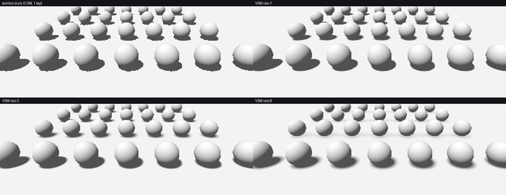
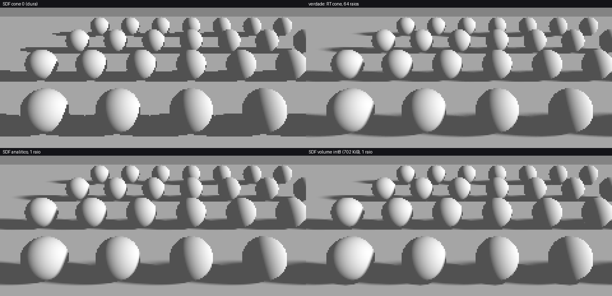
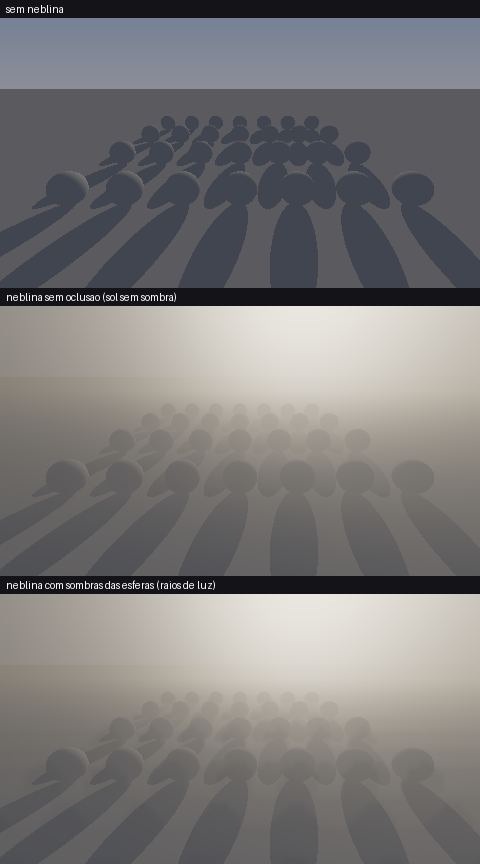
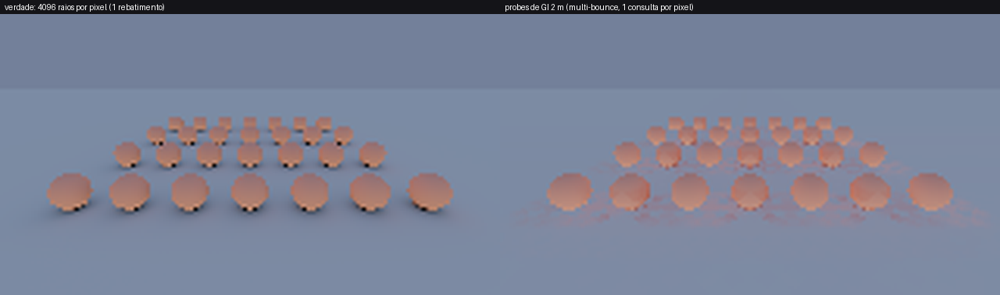

# Fase 6 — VSM, sombras por SDF, neblina volumétrica e probes de GI

Quatro módulos independentes, todos com referência CPU testada (`tests/test_phase6.cpp`, executável `lp_phase6_tests`) e espelho HLSL.
Medições: renderizador por software, 1 thread, Release. O HLSL **não foi compilado** (sem `dxc`) nem executado em GPU.

| Módulo | Arquivos | O que resolve | Memória típica |
|---|---|---|---|
| **VSM** | `Shadow/Vsm.hpp`, `shaders/Common/Vsm.hlsli` | sombra suave com 1 amostra/pixel (sem PCF de N taps) | RG16F: 4 B/texel (4 MiB por cascata 1024²) |
| **SDF** | `Sdf/Sdf.hpp`, `shaders/Sdf/SdfShadow.hlsli` | penumbra física com 1 raio, independe do nº de objetos | 702 KiB (28×8×48 m a 25 cm, int8) |
| **Neblina** | `Volumetric/Fog.hpp`, `shaders/Volumetric/FogScatter.compute.hlsl` | espalhamento, raios de luz, atenuação por distância | 900 KiB (80×45×32 froxels RGBA16F) |
| **Probes de GI** | `Rt/ProbeGrid.hpp`, `src/Rt/ProbeGrid.cpp`, `shaders/Rt/ProbeGrid.hlsli` | luz de céu + cor rebatida (difusa), dinâmica | 83 KiB para 728 probes de 2 m (FP16) |

## 1. VSM (Variance Shadow Maps)
O mapa guarda `E[d]` e `E[d²]`. Como são momentos, podem ser filtrados (blur separável, mip, bilinear), e a desigualdade de Chebyshev dá a fração iluminada:
`P ≤ σ² / (σ² + (t − μ)²)`. `bleedReduction` remapeia a probabilidade para cortar o vazamento clássico de luz.
- **Propriedade testada exatamente:** Chebyshev é limite superior da fração iluminada: 20 000 amostras aleatórias, **0 violações**.
- Penumbra proporcional ao raio do blur (0 → 0 texels, 3 → 6, 8 → 16).
- Vazamento (receptor atrás de 2 oclusores): 7,4 % no Chebyshev puro → 0,0 % com `bleedReduction = 0,3`.
- Ponta a ponta no CSM da cena demo: longe das bordas, **0 %** de erro (umbra clareada e luz escurecida); erro absoluto médio 0,0025 (raio 1) a 0,015 (raio 8).
- Troca: `bleedReduction` alto = menos vazamento e penumbra mais dura (0,9 quase some com a penumbra). Padrão recomendado: 0,3.
- Custo: passe depth→momentos + 2 passes de blur por cascata (CPU: 17 ms sem blur, ~150 ms com blur, 3 cascatas 1024²), e o passe de sombra precisa escrever momentos (ou converter o depth).

*Sombra dura (serrilhada) vs VSM com raios 1, 3 e 8.*

## 2. Sombras suaves por SDF
Sphere tracing: o campo diz o raio livre, então cada passo é seguro. A fração do disco da luz coberta vem de `s = h / (t·tan α)` (h = distância do raio ao oclusor):
`vis = ½ + (s√(1−s²) + asin s)/π` (área do segmento circular), mínimo ao longo do caminho. **O raio continua por dentro do oclusor** (h < 0) para
produzir a metade escura da penumbra; sem isso a penumbra ficava toda do lado iluminado (erro 0,148 → 0,048 depois da correção).
- Sombra dura: SDF vs BVH, **0,08 %** de pixels discordantes.
- Penumbra (2 538 px, cone 0,05 rad) vs RT de 64 raios: erro **0,048** (analítico) e 0,095 (volume int8 a 25 cm); fingir sombra dura dá 0,233.
- Custo por pixel (CPU): **SDF em volume 306 ns** · SDF analítico 1 374 ns · RT 16 raios 1 614 ns · RT 64 raios 6 383 ns.
- **Limite de distância:** com `tMax = 1,5 m`, 24,1 → 5,4 passos/pixel. Com distância **truncada** em `maxDist` (int8), o alcance seguro é `0,9·maxDist/tan α`
  (`SafeShadowRange`); além disso a sombra escurece sem motivo (achado do teste: erro 0,23 antes de impor o limite).
- Objeto movido: rebake local de 3,6 % dos voxels, **idêntico** ao bake completo.

*Dura, verdade (RT 64 raios), SDF analítico (1 raio) e volume int8 (1 raio).*

## 3. Neblina volumétrica
Froxels com profundidade exponencial (como os slices dos clusters). Para cada coluna, de perto para longe:
`S = σs·Σ fase·radiância·visibilidade`, `L += T·(S − S·e^{−σt Δt})/σt`, `T *= e^{−σt Δt}` — a integral é **analítica por froxel**, então é exata para S e σt constantes.
O pixel faz uma leitura trilinear: `cor = cor·T + L`. Fase de Henyey–Greenstein (normalização testada, 4 valores de g).
- Meio homogêneo vs solução analítica: erro **7,5e-6** (12 slices).
- Cena com as sombras das esferas vs marcha fina de 256 passos/pixel: 16 slices **2,7 %**, 32 slices **1,2 %**, 64 slices 1,1 % de erro na luz espalhada; 900 KiB; 115 200 raios de visibilidade em ~7 ms (CPU).
- Sombras das esferas aparecem no volume (luz espalhada com oclusão = 92 % da sem oclusão).
- **Limite de distância:** o volume cobre `[near, maxDistance]`; além disso a neblina é constante (nenhum froxel avaliado; testado).
- A visibilidade do sol é um callback (`VisibilityFn`): CSM, VSM, RT ou SDF.

## 4. Probes de GI (DDGI simplificado)
Grade regular; cada probe lança `raysPerProbe` raios (Fibonacci com rotação aleatória por quadro), acerta o BVH ou o céu, sombreia o ponto de acerto (sol + indireto da própria grade = multi-bounce) e guarda a **irradiância SH9 convoluída**. Mistura com histerese; `Update(budget)` em round-robin.
Recepção: 8 probes × peso trilinear × face × **visibilidade** (momentos de distância num mapa octaédrico 4×4 com pesos cos³², Chebyshev).
- Probes em espaço livre vs verdade (4096 raios): erro **2,5 % (1 quadro) → 1,3 % (8) → 0,6 % (64)** com 64 raios/probe/quadro.
- Entre probes (2 m): 0,8 % com visibilidade, 1,5 % só trilinear.
- **Vazamento por parede fina:** 0,418 (só trilinear) → **0,0005** com visibilidade (verdade 0). Dois achados do teste: 8 octantes eram grossos demais; e o lóbulo cos⁸ borrava a distância (margem de 10 cm) — com cos³² o vazamento some (um deslocamento extra da média em ½σ foi testado e **não** era necessário; removido).
- Orçamento: 4 quadros de 1/4 dos probes cobrem todos (11 648 raios por quadro em vez de 46 592).
- Objeto movido: `InvalidateRegion` (raio configurável) re-converge mais rápido: erro 0,036 vs 0,091 após 3 quadros só com histerese.
- Consulta por pixel ~400× mais barata que 4096 raios (0,42 µs vs 181 µs).
- **Limitação clara:** é GI de baixa frequência. A verdade mostra escurecimento de contato sob as esferas que os probes de 2 m **não** reproduzem: combine com SSAO/RT-AO (Fase 4/5). Probes dentro de geometria não são realocados (o visibilidade os descarta).

## Como combinar (preset sugerido)
| Tier | Sombra | AO | GI | Neblina |
|---|---|---|---|---|
| Mobile / low | CSM + PCF 1 tap ou VSM raio 1–2 | SSAO meia-res | SH L1 do IBL | froxels 64×36×16, sem sombra no sol |
| Médio | CSM + VSM ou SDF (volume) | SSAO + RT-AO curto | probes 2–4 m, orçamento 1/8 | 80×45×32 com sol sombreado |
| High | CSM + RT sombra de contato | RT-AO | probes 1–2 m + PRT | 160×90×64 |

## Limitações (sem rodeios)
- HLSL não compilado/testado em GPU. O passe de **atualização** dos probes (raios por probe + histerese) ainda não tem versão HLSL; só a consulta.
- Sem backend DXR/Vulkan RT: o BVH em software é a única implementação.
- VSM: vazamento residual com oclusores sobrepostos e `bleedReduction` não é de graça; PCF segue melhor para sombras muito nítidas.
- SDF: o volume é uniforme (sem cascatas); cenas grandes precisam de várias cascatas ou de brick maps; o campo de planos infinitos fica truncado.
- Neblina: sem reprojeção temporal nem jitter (o ganho de qualidade com poucos slices vem daí na prática); densidade espacialmente homogênea ou só por altura.
- Probes: sem realocação de probes dentro de geometria, sem múltiplas cascatas de grade.

## Validação por mutação
24 mutações injetadas à mão (VSM, SDF, neblina, probes): **19 pegas**. A primeira rodada deixou 11 sobreviventes; 5 eram lacunas de teste e foram fechadas
(acne do VSM: piso de variância e bias de inclinação; forma exata do disco da luz; codificação int8 do volume; contagem exata da invalidação dos probes).
Um deles ainda revelou código desnecessário (o deslocamento da média em ½σ nos probes), removido. Ficam **5 sobreviventes aceitos**, todos equivalentes ou heurísticos:
bias de profundidade do `VsmSampleCascade` (o piso de variância já cobre a cena de teste), saída antecipada `s ≤ −1` e passo `|h|` dentro do oclusor no SDF
(só custo, o resultado satura igual), piso 0,2 do peso de face e cubo da visibilidade dos probes (constantes de ajuste).
