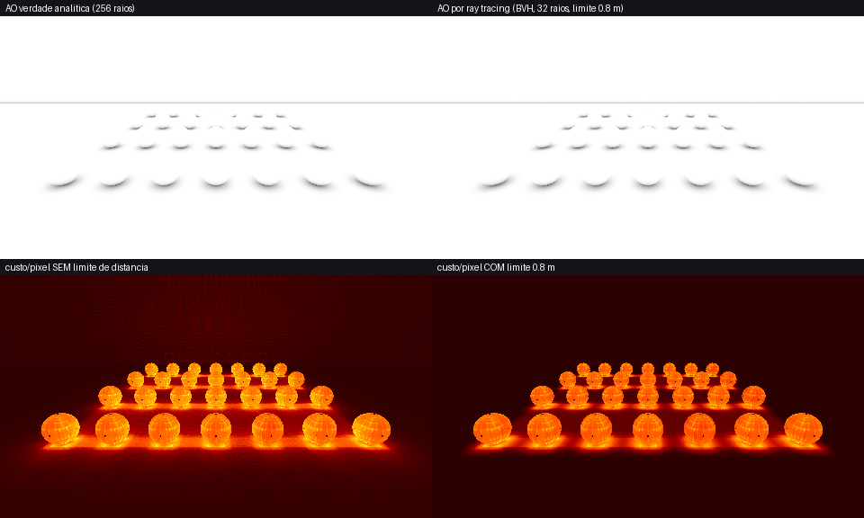
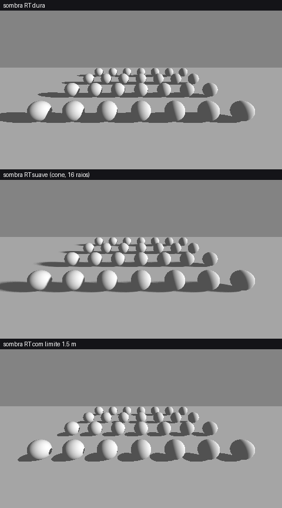
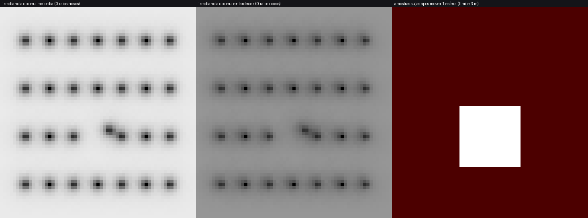

# Fase 5b/5c — Ray tracing por software, com limite de distância e com cache

Tudo é C++17 puro, sem DXR/Vulkan RT: roda em qualquer GPU (o espelho HLSL usa compute) e na CPU para ferramentas e testes.
Código: `include/LightPrism/Rt/{Bvh,RtEffects,Transfer}.hpp`, `src/Rt/*.cpp`, `shaders/Rt/*`. Testes: `tests/test_rt.cpp` (`lp_rt_tests`).

## 1. BVH (`Rt::Bvh`)

| Decisão | Motivo |
|---|---|
| Nó de **32 bytes**, filhos **adjacentes** (um índice por nó interno), folhas de até 4 triângulos | uma linha de cache por nó; mesma struct vai para um `StructuredBuffer` |
| **SAH binned** (16 bins, 3 eixos) | melhor qualidade de travessia: geometria estática |
| **LBVH de Karras** (Morton 30 bits, empate por índice) | construção O(n log n), 3–5× mais rápida: geometria dinâmica |
| Travessia **ordenada** (filho mais próximo primeiro), pilha de 64, descarte do que ficou atrás de um acerto | menos nós por raio |
| **Limite de distância** = `Ray::tMax` | poda subárvores inteiras: o raio nunca visita o que está além |
| `Occluded` (any-hit) separado de `Intersect` | sombra/AO binário sai no primeiro acerto |
| `Refit` | objeto que se move/deforma sem mudar a topologia: só recalcula caixas (bottom-up por índice reverso) |

Medido (`lp_rt_tests`, Release, 1 thread): 20 000 triângulos aleatórios — SAH: custo 83, build 20 ms; LBVH: custo 103, build 4 ms.
Raios curtos (limite 1,5 m) visitam **~70 % menos nós** e rodam ~4× mais rápido que raios infinitos (2,8 vs 0,7 Mraios/s).
Cena do demo (26 884 triângulos, esferas+planos tesselados): 1,8 MiB, 5,7 nós por raio de AO.
Corretude: 4 000 raios infinitos + 4 000 com limite aleatório contra força bruta, nos dois construtores, **0 divergências**
(`t`, `Occluded`, nunca devolve acerto além do limite); casos degenerados (vazio, 1 triângulo, 500 idênticos, área zero).

## 2. Efeitos com limite de distância (`RtEffects.hpp`)

- `RtSunVisibility`: sombra do sol dura (1 raio) ou suave por cone (`coneHalfAngle`, N raios); `maxDistance` ignora oclusores longínquos.
  Use **híbrido**: CSM para o alcance longo, RT para contato/detalhe até `maxDistance`.
- `RtAmbientOcclusion`: mesmo estimador do SSAO de referência (cosseno + atenuação linear `1 − t/raio`), com `raio = limite de distância`.
  Contra a verdade analítica (256 raios): erro médio **0,0005**, 0,009 nos pixels ocluídos.


*Em cima: AO analítico vs AO por RT. Embaixo: custo (nós visitados) por pixel sem limite vs com limite 0,8 m — o limite concentra o trabalho perto dos objetos.*


*Sombra RT dura, suave (penumbra cresce com a distância ao oclusor) e limitada a 1,5 m (só sombra de contato).*

## 3. Ray tracing que guarda o cálculo: PRT (`Rt::TransferCache`)

A pergunta "dá para salvar os cálculos?" — **sim, a parte cara é a visibilidade, e ela só depende da geometria**.
Para cada amostra (ponto + normal) guardamos 9 floats `T_k = ∫ V(ω)·max(0,n·ω)·Y_k(ω) dω` (visibilidade × cosseno em SH9,
bake com raios limitados a `maxDistance`). Depois, a luz do céu em qualquer momento é `E/π = (1/π)·Σ T_k·L_k`, 9 MADs por canal:

| Evento | Custo |
|---|---|
| Hora do dia / nuvem / giro do HDRI mudou | **0 raios** (só os 9 `L_k`): medido 9,4 ns por amostra |
| Um objeto se moveu | só as amostras a menos de `maxDistance` da caixa antiga ∪ nova ficam sujas (`InvalidateRegion`); no teste 11,5 % das amostras, **8× menos trabalho** que rebake total |
| Várias amostras sujas | `Bake(budget)` refaz `budget` por quadro: custo previsível (bake completo diluído em N quadros) |
| Exatidão | o bake é determinístico por amostra: **re-bake incremental == bake do zero, bit a bit** (testado em todas as 5 370 amostras) |

Precisão: sem oclusão, T reproduz o SH convoluído do IBL com erro relativo 0,03 %; em cena ocluída vs força bruta
independente (4 096 raios): erro médio 0,9 %, máximo ~7–10 % só em amostras na borda de contato (256 raios binários).
Memória: 36 B por amostra (9 floats; 18 B em FP16). Bake: 6,7 Mraios/s, 5 370 amostras × 256 raios em ~100 ms.


*Irradiância do céu em planta (sombras de contato sob as esferas, limite 3 m) no meio-dia e no entardecer sem nenhum raio novo; e as amostras invalidadas ao mover uma esfera.*

Uso típico:
```cpp
Rt::TransferCache prt;  prt.Init(samples, {/*maxDistance*/ 4.0f, /*rays*/ 256});
prt.Bake(bvh);                                   // carregamento (ou em fatias por quadro: prt.Bake(bvh, 500))
// por quadro, a hora do dia mudou:
Ibl::Sh9 L = Ibl::ProjectToSh(sky);              // 9 coeficientes; nenhum raio
Vec3 ambient = prt.Irradiance(i, L) * albedo;    // por amostra (ou por vértice/lightmap texel/probe)
// objeto dinâmico moveu:
bvh.Refit(newTris);  prt.InvalidateRegion(oldBox);  prt.InvalidateRegion(newBox);  prt.Bake(bvh, budget);
```

## O que veio do documento de técnicas avançadas (PDF)

| Técnica | Decisão |
|---|---|
| LBVH/Karras | **adotado** (modo `BvhBuild::Lbvh`) |
| PRT com SH | **adotado** (`TransferCache`) |
| Sombra planar de Blinn | **adotado** (`Shadow/PlanarShadow.hpp`) |
| Wave intrinsics, SDF soft shadows/JFA, Hi-Z SSR, dual paraboloid, oblique clipping | **adiados** (Fase 6; dependem de passes da engine) |
| Geração de código com LLVM/DSL | descartado: complexidade sem ganho para uma biblioteca leve |

## Limitações (sem rodeios)

- O espelho HLSL (`shaders/Rt/`) **não foi compilado** (sem `dxc` no ambiente) nem executado em GPU; a CPU é a referência testada.
- Não há backend DXR/Vulkan RT: a interface `Bvh` foi pensada para ser trocada por `TraceRay` mantendo os efeitos.
- O PRT é **difuso** de baixa frequência (SH9): não faz sombras nítidas do sol (use `RtSunVisibility`/CSM), e a visibilidade é binária dentro de `maxDistance`.
- A reconstrução do BVH é de um bloco só (sem BVH de duas camadas): para muitos objetos móveis use `Refit` por malha ou um TLAS na engine.
- O BVH ainda não é paralelo (as threads são da engine; o LBVH foi escolhido por ser paralelizável).
