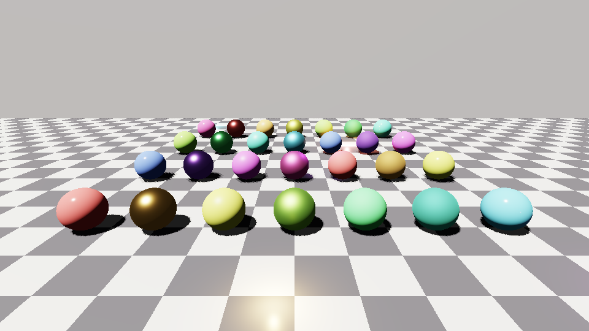
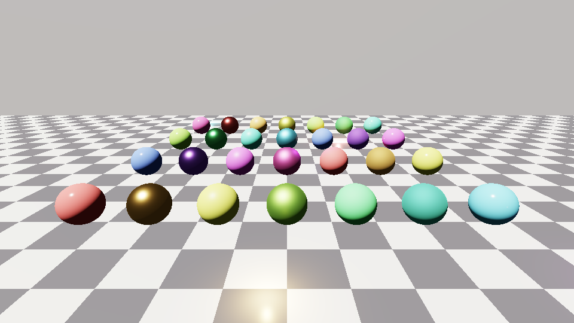
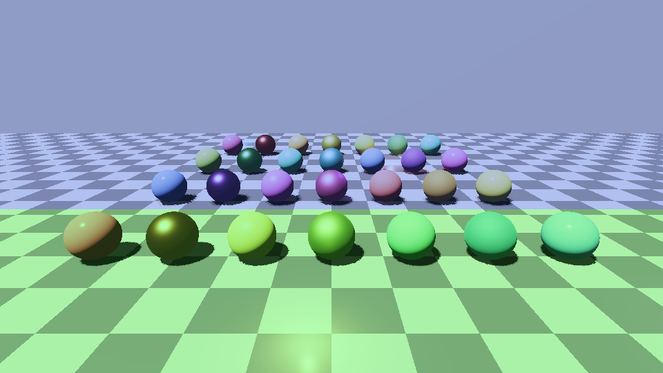

# Fase 3: Cascaded Shadow Maps (luz direcional)



| sem sombras | cascatas (verde = 2, azul = 3) |
|---|---|
|  |  |

A biblioteca calcula as cascatas e sobe os dados; **o desenho dos shadow maps é da engine hospedeira** (o RHI não tem
draw). O HLSL (`shaders/Common/Shadow.hlsli`) amostra os mapas, e a referência C++ (`Shadow/Csm.hpp`) é a versão testada.

## Fluxo por frame

```cpp
LightPrism::CsmSystem csm(LightPrism::MakeCsmConfig(quality));   // cascatas, resolução e PCF vêm da qualidade
...
const auto& frame = lights.BuildFrame(fp);
csm.Update(*device, frame, {view, proj00, proj11, zNear, zFar});  // calcula + sobe o cbuffer (352 B)

// Na engine: para cada cascata i < csm.Result().gpu.cascadeCount
//   renderize só profundidade dos casters com csm.Result().gpu.cascades[i].viewProj
//   numa fatia i de uma Texture2DArray de shadowMapSize² (depth convencional: perto = 0, longe = 1).
// No passe de iluminação: #define LP_ENABLE_CSM antes de incluir ClusterLighting.hlsli;
//   ligue csm.Buffer() em b2, a Texture2DArray em t10 e um sampler de comparação LESS_EQUAL em s1.
```

Sem sol, ou sol sem `LightFlag_CastShadows`, ou câmera inválida: `cascadeCount = 0` e o shader devolve visibilidade 1.

## Como evita o tremor

1. Cada cascata envolve a fatia do frustum numa **esfera**; o raio só depende de near, far e projeção, nunca da
   rotação da câmera (arredondado a 1/16 m).
2. O centro, em espaço de luz (rotação fixa, origem no mundo), é **fixado numa grade de texels**. Um ponto fixo do
   mundo cai sempre na mesma posição fracionária do texel, qualquer que seja a posição ou a orientação da câmera.
3. O raio ganha **1 texel de folga**, porque o snapping desloca o centro até meio texel e sem isso um canto da fatia
   poderia sair da caixa.

Splits "práticos" (mistura de uniforme e logarítmico, `splitLambda`). Cada cascata cobre também a faixa de blend da
anterior, e o fim de cada cascata faz fade (`blendFraction`) para a próxima. Bias: `depthBias` em metros e
`normalBias` em texels ao longo da normal. PCF de 1, 4 ou 9 amostras, escolhido pelo preset de qualidade
(Mobile 1 cascata/1 amostra, High 4 cascatas/4096²/9 amostras).

## Validação (sem GPU)

`lp_shadow_tests` roda tudo no renderizador por software:

| Verificação | Resultado |
|---|---|
| Splits contíguos, uniforme/log, limites 1..4, entradas inválidas | ok |
| Os 8 cantos de cada fatia ficam dentro de cada cascata (60 poses aleatórias) | ok |
| Raio idêntico em 80 orientações e posições aleatórias | ok |
| **Estabilidade:** posição fracionária de um ponto fixo, 200 poses, 3 cascatas | desvio < 0,02 texel (sem snapping: > 0,1) |
| Esfera da fatia sempre dentro da caixa após o snapping (800 casos) | ok |
| Blend: 0% no início da faixa, 50% no meio, 100% no fim | ok |
| **Shadow map vs oclusão analítica** (raio até o sol contra a cena), 125 621 pixels voltados ao sol | **0 divergências** nos 120 136 pixels longe de bordas de sombra; 5,9% nas bordas (resolução de texel) |

O teste de ponta a ponta ignora pixels de costas para o sol (N·L ≤ 0): o sol não os ilumina de qualquer forma, e o
normal bias os empurra para fora da silhueta. "Longe de borda" = o resultado analítico é igual em 4 pontos deslocados
5 texels no plano tangente. Quebrei o CSM de propósito de cinco formas (range de profundidade errado, caixa
deslocada, raio dependente da rotação, sem folga de texel, normal bias com sinal trocado) e o teste falha em todas.

## Limitações conhecidas

- Só a luz direcional tem sombra. Pontuais e spots (cubemap/atlas) ficam para uma fase seguinte.
- O HLSL não foi compilado (sem `dxc` aqui). Ele usa `SampleCmp` (PCF bilinear por hardware); a referência CPU
  compara por texel, então as bordas diferem levemente.
- `casterExtension` (padrão 60 m) define até onde, em direção à luz, casters fora do frustum ainda projetam sombra.
  Aumente em cenas com montanhas ou prédios altos; reduzir melhora a precisão de profundidade.
- `depthBias` e `normalBias` foram ajustados para a cena de demonstração; ajuste para a escala da sua engine.
