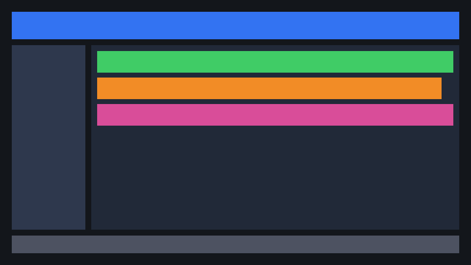
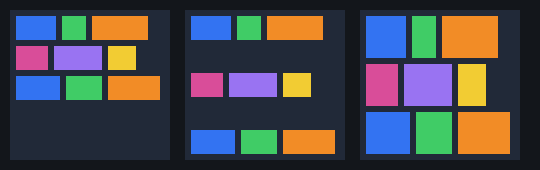
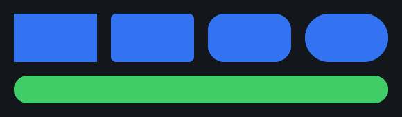
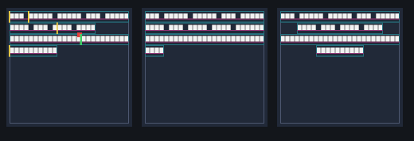

# SpriteUI

**Versão CMake:** 0.6.0 — núcleo C++20 (layout, input, widgets, docking, texto, config). A versão ainda não implica uma release publicada. Estado atual: `docs/IMPLEMENTATION_STATUS.md`; checklist de release: `docs/RELEASE_CHECKLIST.md`.

SpriteUI é o início executável de uma biblioteca de interface 2D orientada a dados. O núcleo matemático, input, widgets lógicos, animação e extração de comandos são independentes de ECS e de API gráfica. Na ToolEngine, a integração pretendida é com o ECS e o RHI próprios da engine; Flecs e um backend Diligent paralelo não são requisitos do core.

SpriteUI não depende de Dear ImGui. A remoção do ImGui do editor da ToolEngine é um objetivo de integração separado e ainda não concluído; o caminho planejado é migrar as telas gradualmente e remover a dependência do host somente depois de validar a substituição.

> Importante: o core não cria uma janela nem possui backend de produção. O visualizador SDL3 opcional demonstra uma cena em CPU; a integração com o RHI da ToolEngine, submissão a GPU real e shaping de fontes de produção ainda são etapas futuras.

## Funcionalidades implementadas

- ABI `SpriteInstanceGPU` com 80 bytes, alinhamento 16 e verificações de layout/offset em compilação.
- Conversão de cor sRGB → linear e premultiplicação de alpha.
- Canvas Screen/World e modo Unlit/ClusterLit com validação das combinações permitidas.
- Anchors/offsets e transformação 2D com pivô, escala e rotação.
- Transformação local em pixels para hit-testing coerente com o tamanho lógico do widget.
- Handles com índice + geração para evitar referências recicladas.
- Roteamento de input com hover, foco, captura, click, wheel, move e cancelamento por perda de foco.
- Roteamento core multi-pointer com estados independentes por ponteiro e cancelamento de ponteiros ausentes por frame.
- Propagação de eventos pelos ancestrais (`HitTarget::parent`) e consumo de input por alvo/ancestral.
- Navegação espacial por teclado/gamepad e eventos semânticos `Activate`/`Cancel`.
- Slider com clamp, domínio, passo opcional e proteção contra largura zero.
- ScrollView com limites `contentSize - viewportSize`.
- ToonMotion básico com easing, `Override`/`Queue`/`Ignore`, pausa/cancelamento e shake sem drift.
- Amostragem stateless de tracks de animação por keyframes em `Animation::ToonTimeline`; relógio, looping e aplicação em ECS continuam a cargo do host.
- Flags de invalidação por subsistema.
- Extração de instâncias, ordenação visual e batching apenas entre comandos consecutivos compatíveis.
- Referência de ícone em atlas por slice/UV/tamanho de origem (`Rendering::UIIcon`) e opacidade animável por item, sem alterar a ABI GPU.
- Árvore de layout com relações explícitas, remoção recursiva segura e validação de parent handles.
- Alinhamento transversal de itens (Stretch/Start/Center/End).
- Flex wrap, alinhamento de conteúdo e alinhamento por baseline em linhas.
- Quebra de texto por palavra no subconjunto implementado, incluindo regras para espaços, hífen, ZWSP, NBSP, CJK e clusters.
- Nine-Slice e referência CPU para painéis SDF arredondados.
- Interseção de clipping hierárquico para renderização e clip bounds em hit-testing.
- Validação estrutural de `FramePacket` antes da submissão.
- Shader HLSL de referência alinhado à ABI.
- `NullRenderBackend`, exemplo CLI e testes automatizados.

## Ainda não implementado

| Módulo | Estado |
|---|---|
| Flexbox | Wrap, `alignContent`, baseline, `justifyContent` e grow/shrink com limites implementados; não cobre toda a especificação CSS |
| Adaptador para o ECS próprio da ToolEngine | Pendente; não adicionar Flecs para essa integração |
| Backend via RHI da ToolEngine | Implementado no repositório da engine (módulo `ui_sprite`, opcional). Limites: atlas único em alfa, sem SDF/MSDF real, validado em OpenGL; Vulkan e D3D12 ainda sem teste de pixels |
| SDL3 | Wrapper opcional, mouse/foco, touch/finger multi-pointer, navegação por teclado/gamepad, entrada de texto/IME e clipboard; GLFW pendente |
| GLFW | Pendente |
| Widgets visuais (desenho), drag & drop de docking | Pendente (lógica de widgets, janelas, abas e dock tree implementada) |
| HarfBuzz, FreeType e atlas MSDF de produção | Pendente. Há um atlas stb_truetype opcional (alfa, sem kerning; ver abaixo) |
| Playback/looping de timeline, editor de keyframes e integração ECS | Pendente; a amostragem stateless de keyframes está implementada |
| KTX2/Basis, streaming e eviction por fences | Pendente |
| Light Prism ClusterLit, Bloom, Acrylic Blur e sombras | Pendente |
| Partículas e nodes de editor | Pendente |
| QuickJS sandbox e FFI | Pendente |

O estado completo e os limites verificados estão em `docs/IMPLEMENTATION_STATUS.md`. Os documentos de arquitetura descrevem também funcionalidades planejadas; consulte neles as seções de estado antes de tratar uma integração como concluída.

Referência dos módulos e fluxo público: [`docs/API_REFERENCE.md`](docs/API_REFERENCE.md). A geração HTML por Doxygen é opcional (`SPRITEUI_BUILD_DOCS=ON`) e requer Doxygen instalado.

## Início rápido

Exemplo mínimo de extração e validação de um pacote de renderização, sem janela nem GPU:

```cpp
#include <SpriteUi/SpriteUi.hpp>

#include <vector>

int main() {
    using namespace ToolEngine::SpriteUi;

    Rendering::UIRenderItem item;
    item.handle = {1, 1};
    item.layout.resolvedPosition = {20.0f, 20.0f};
    item.layout.resolvedSize = {160.0f, 40.0f};

    Rendering::RenderExtractor extractor;
    const std::vector<Rendering::UIRenderItem> items{item};
    const auto packet = extractor.Build(1, items);

    Rendering::NullRenderBackend backend;
    return backend.Submit(packet) ? 0 : 1;
}
```

O exemplo não cria nem desenha uma janela. Para compilar um consumidor instalado, veja o teste `tests/package_consumer` e as instruções de build abaixo.

### Visualizador interativo (SDL3, rasterização de referência em CPU)

Para experimentar cores, painéis arredondados, clipping, estados de interação e a fonte Xmind numa janela, habilite o visualizador opcional:

```sh
cmake -S . -B build-visual -DSPRITEUI_BUILD_VISUALIZER=ON
cmake --build build-visual --target spriteui_visualizer
./build-visual/spriteui_visualizer
```

É necessário SDL **3.2+** com pacote CMake `SDL3`. No Windows, execute `build-visual\Debug\spriteui_visualizer.exe` (ou `Release`, conforme a configuração). O visualizador reutiliza o `RenderExtractor` e o rasterizador por software usado pelos testes; clique em **CYCLE PALETTE**, alterne o toggle e arraste o slider. Na barra lateral, clique no campo preenchido com **god only knows** para editar: texto UTF-8 é inserido no cursor, setas/Home/End movem o cursor, Backspace/Delete apagam caracteres e Enter imprime no console o valor retornado pela aplicação. Para manter a interação responsiva, a janela renderiza a prévia em metade da resolução e amplia a imagem; pressione **S** para salvar um PNG em resolução integral em `snapshots/` (ou no diretório definido por `SPRITEUI_SNAPSHOT_DIR`). Para gerar uma captura padrão sem abrir uma janela, execute `spriteui_visualizer --headless`; o PNG `spriteui_visualizer_preview.png` será salvo no diretório de snapshots. O CTest exercita esse modo sempre que o visualizador e os testes estão habilitados, incluindo validação de edição/readback do campo.

O visualizador carrega `Fonts/Xmind/static/Xmind-Regular.ttf` e `fotos/LOGO.png` por padrão. O logo aparece em um cartão de anúncio e passa pelo `UIIcon`, extração de draw-list e amostragem da textura pelo rasterizador CPU. Os arquivos são carregados pelo Windows Imaging Component (PNG) e GDI (fonte), sem acrescentar dependências ao core. O CTest headless verifica texto antialiasado, o campo e pixels visíveis da imagem. Use `--image <PNG-path>` para selecionar outra imagem compatível. A cena também demonstra estilos tipográficos predefinidos (`Title`, `Subtitle`, `Body`, `Label`, `Caption`, `Metric` e `Footer`), abas clicáveis, aba ativa com gradiente horizontal de duas cores, botões flutuantes e fade do botão de ação via `ToonMotionSystem`. Para outra fonte TrueType/OpenType, use `--font "C:\fonts\MinhaFonte-Bold.ttf"`. O asset Xmind é distribuído sob a SIL Open Font License, incluída em `Fonts/Xmind/OFL.txt`. O carregador de fontes/imagens do visualizador atualmente usa APIs Windows.

**Limite importante:** esta janela não usa a GPU e não representa a qualidade final de fontes ou texturas. No Windows, o visualizador rasteriza glifos Latin-1 com GDI para um atlas de cobertura em tons de cinza; esse caminho não executa shaping complexo, kerning, bidi, texto colorido ou MSDF. O gradiente usa uma textura sintética do harness; não adiciona um tipo de gradiente ao ABI de produção. `UIIcon` referencia regiões de atlas existentes, mas o core não decodifica SVG/PNG: a importação/rasterização e o lifetime do atlas pertencem ao pipeline de assets do host.

### Adaptador opcional SDL3

O target opcional `SpriteUi::SDL3Input` fornece um wrapper de ciclo de vida/configuração básica de janela, conecta eventos SDL3 de mouse/foco ao `UIInputSnapshot`, converte teclado/gamepad em comandos semânticos de navegação e expõe entrada de texto/IME e clipboard. Não escolhe uma API gráfica. O core `SpriteUi::SpriteUI` continua sem dependências SDL3.

```sh
cmake -S . -B build-sdl -DSPRITEUI_BUILD_SDL3_ADAPTER=ON
cmake --build build-sdl --parallel
```

É necessário SDL **3.2+** instalado com o pacote CMake `SDL3`. A aplicação hospedeira inicializa SDL; dentro da rotina de inicialização, pode criar uma janela pelo wrapper e encaminhar cada evento:

```cpp
Platform::SDL3WindowConfig windowConfig;
windowConfig.title = "My SpriteUI application";
windowConfig.flags = SDL_WINDOW_RESIZABLE;
std::string windowError;
auto window = Platform::SDL3Window::Create(windowConfig, windowError);
if (!window) {
    // Report windowError through the host application's error path.
    return;
}

Platform::SDL3InputAdapter platformInput(window->GetNativeHandle());
SDL_Event event;
while (SDL_PollEvent(&event)) {
    platformInput.ProcessEvent(event);
}
const auto snapshot = platformInput.BuildSnapshot(frameId);
const auto uiEvents = eventRouter.Process(snapshot, hitTargets);
const auto navigationEvents = navigationRouter.Process(
    platformInput.ConsumeNavigationCommand(), focusCandidates);

if (textFieldFocused) {
    if (!platformInput.SetTextInputActive(true)) {
        // Report SDL_GetError() through the host application's error path.
    }
    if (!platformInput.SetTextInputArea(caretX, caretY, caretWidth, caretHeight, caretOffset)) {
        // Report SDL_GetError() through the host application's error path.
    }
} else {
    if (!platformInput.SetTextInputActive(false)) {
        // Report SDL_GetError() through the host application's error path.
    }
}
const std::string committed = platformInput.ConsumeCommittedText();
const auto& composition = platformInput.GetTextComposition();
// Forward committed and composition text/range to the focused text widget.

if (!Platform::SDL3InputAdapter::SetClipboardText(committed)) {
    // Report SDL_GetError() through the host application's error path.
}
std::string clipboardText;
if (Platform::SDL3InputAdapter::GetClipboardText(clipboardText)) {
    // Paste clipboardText into the focused widget.
}
```

O comando de navegação é consumido uma vez por chamada; se vários comandos chegarem antes do consumo, o primeiro é preservado. Teclas repetidas são tratadas, mas não repetem ações. `ConsumeCommittedText()` retorna o texto UTF-8 confirmado desde a última leitura; `GetTextComposition()` fornece o texto de composição IME ativo e seu intervalo de seleção, copiados do evento SDL. O retângulo da área IME usa coordenadas da janela SDL e deve acompanhar o caret. Clipboard é global ao processo/ambiente SDL: `SetClipboardText`, `GetClipboardText` e `HasClipboardText` são estáticos e devem ser chamados na thread principal. As operações retornam `false` em caso de falha; quando a falha vier do SDL, consulte `SDL_GetError()` imediatamente. A escrita rejeita NUL embutido porque a API SDL recebe uma string terminada em NUL. Eventos de teclado/texto de outras janelas são ignorados. Como eventos de gamepad não identificam uma janela, eles são encaminhados somente enquanto a janela associada ao adaptador estiver focada. Os métodos SDL, incluindo criação/destruição e operações de janela, devem ser usados na thread principal. O wrapper possui a janela e a destrói no destrutor; não inicializa nem encerra o subsistema SDL. A aplicação hospedeira continua responsável por `SDL_Init`/`SDL_Quit`. O target de integração é `SpriteUi::SDL3Input`; faça `find_package(SDL3 3.2 CONFIG REQUIRED)` e inclua `<SDL3/SDL.h>` para constantes SDL.

## Atlas de glifos stb_truetype (opcional)

`SpriteUi::TextStb`, ligado com `-DSPRITEUI_WITH_TEXT_STB=ON` (padrão OFF), monta um atlas de cobertura alfa de 8 bits a partir de um TTF/OTF com `BuildTruetypeAtlas`, e converte UTF-8 em `GlyphInstance` com `ShapeTruetype`. Usa a convenção do `DebugShaper` (`unitsPerEm = 1000`, `planeBounds` com y para cima, `uvRect` normalizado).

Limites deste passo: um glifo por codepoint, sem kerning, ligaduras ou marcas combinantes; atlas de rasterização, não SDF/MSDF, então o texto fica serrilhado longe do tamanho rasterizado; uma página só; o pixel (0,0) do atlas fica reservado (padding ≥ 1). O núcleo `SpriteUI` continua sem essa dependência. `stb_truetype` (public domain ou MIT) está em `third_party/stb/`, com nota de procedência. A biblioteca não valida o conteúdo da fonte: carregue apenas fontes confiáveis. Os testes estão em `tests/test_truetype_atlas.cpp` (`SpriteUI.TruetypeAtlas`).

## Backend RHI da ToolEngine (opcional)

Na engine, o módulo header-only `ui_sprite` (`engine/ui_sprite/include/tool/ui/spriteui_rhi.hpp`, ligado com `TOOL_WITH_SPRITEUI`) implementa `IRenderBackend` sobre `tool::rhi::IDevice`. Cada `SpriteInstanceGPU` vira um quad de quatro vértices expandidos na CPU, num único vertex buffer por quadro, na ordem do pacote. Cada trecho com o mesmo recorte vira um `drawIndexedRange` com `setScissor`. O blend é premultiplicado (`ONE`, `INV_SRC_ALPHA`). Os shaders são `assets/shaders/spriteui.hlsl` e, para OpenGL, os GLSL gerados por `tools/shaders/build_glsl.py`.

Para isso o RHI ganhou três extensões: `PipelineDesc::blendPremultiplied`, `ICommandList::setScissor` e `ICommandList::drawIndexedRange(firstIndex, count)`. O Diligent liga o scissor no rasterizador. O dispositivo Null implementa as mesmas operações para os testes sem GPU (`tests/test_spriteui_rhi.cpp`). O teste com GPU é `spriteui_gpu_test` (OpenGL via `xvfb-run`): desenha num alvo offscreen e confere pixels de cor sólida, recorte, blend, glifo com cobertura total e parcial, e fundo.

Limites: um atlas único em alfa (o slice 0 é o branco e qualquer outro slice amostra o atlas); `FlagBitmapText` e `FlagMsdfText` valem como cobertura alfa, sem SDF; cantos arredondados usam o SDF de caixa do SpriteUI com 1 px de anti-aliasing; sem sampler (leitura direta com `Load`).

## Capturas de referência

Estas imagens são produzidas pelo backend de software dos testes e documentam resultados CPU; não são capturas de uma GPU ou backend de produção.

| Menu e composição | Texto e layout flexível |
|---|---|
|  |  |
|  |  |

Mais imagens de clipping, baseline, Nine-Slice e ordem de pintura estão em [`docs/img/`](docs/img/).

## Requisitos

- CMake 3.21+
- Compilador C++20 (MSVC 2022, GCC 12+ ou Clang 15+ recomendado)
- Ninja opcional (recomendado)
- DXC opcional para compilar o shader de referência

O núcleo CPU não requer dependências externas.

## Compilar e testar

Windows: execute `scripts\build.bat` (usa Ninja se disponível; caso contrário, usa o gerador padrão do CMake).

Linux/macOS:

```sh
chmod +x scripts/build.sh
./scripts/build.sh
```

Manual:

```sh
cmake -S . -B build -DCMAKE_BUILD_TYPE=Debug
cmake --build build --parallel
ctest --test-dir build --output-on-failure
```

O CTest também instala o pacote num diretório temporário e compila um consumidor separado
com `find_package(SpriteUI CONFIG REQUIRED)`.

Build Release:

```sh
cmake -S . -B build-release -DCMAKE_BUILD_TYPE=Release
cmake --build build-release --parallel
ctest --test-dir build-release --output-on-failure
```

Benchmarks CPU opcionais (informativos, sem limites de aprovação):

```sh
cmake -S . -B build-bench -DSPRITEUI_BUILD_TESTS=OFF -DSPRITEUI_BUILD_BENCHMARKS=ON
cmake --build build-bench --target spriteui_benchmarks --parallel
./build-bench/spriteui_benchmarks
```

## Executar o exemplo

```sh
./build/spriteui_hello
```

No Windows: `build\spriteui_hello.exe` ou `build\spriteui_interaction_demo.exe`.

O exemplo `spriteui_hello` monta três elementos, extrai instâncias, cria batches e imprime estatísticas. O exemplo `spriteui_interaction_demo` demonstra hit-testing com rotação, foco/captura, bubbling, navegação semântica, slider e scroll. Nenhum dos dois abre janela nem envia comandos para uma GPU real.

## Exemplo de hit target transformado

`BuildHitTestTransform` produz a transformação de coordenadas locais em pixels para coordenadas lógicas de ecrã. `localSize` deve conter o tamanho em pixels lógicos:

```cpp
UILayoutRect layout{{120.0f, 80.0f}, {240.0f, 64.0f}, true, false};
UIRectTransform transform;
transform.pivot = {0.5f, 0.5f};
transform.rotationRadians = 0.15f;
transform.scale = {1.0f, 1.0f};

auto localToScreen = BuildHitTestTransform(layout, transform);
if (localToScreen) {
    Input::HitTarget target;
    target.handle = {42, 1};
    target.localToScreen = *localToScreen;
    target.localSize = layout.resolvedSize;
    target.focusable = true;
}
```

## Integração pretendida com uma engine

Na ToolEngine, a integração deve reutilizar o ECS, a janela/input e o RHI já existentes. Não se deve inicializar uma segunda janela SDL3 nem duplicar o bombeamento de eventos; o adaptador de janela SDL3 do SpriteUI é para hosts independentes, não para substituir `tool::IWindow`.

O guia incremental e os critérios de aceite estão em [`docs/TOOLENGINE_INTEGRATION_GUIDE.md`](docs/TOOLENGINE_INTEGRATION_GUIDE.md). Ele não substitui a inspeção do checkout real da ToolEngine: o adaptador ECS, o event tap e o backend RHI permanecem pendentes.

Há dois contratos do host que precisam ser ligados sem concorrer com a infraestrutura existente:

- **Input:** `SdlWindow::pump` já consome a fila SDL. O adaptador SpriteUI pode receber os mesmos `SDL_Event` por um event tap do host, ou o host pode construir `UIInputSnapshot`; não se deve chamar um segundo `SDL_PollEvent`. O `RawInput` atual não carrega posição absoluta do mouse nem texto/IME, então essas informações precisam vir do event tap ou de uma extensão explícita do input da engine.
- **Renderização:** `FramePacket` e `SpriteInstanceGPU` continuam sendo a fronteira estável. O backend implementado (`ui_sprite`) expande os quads na CPU e usa `IDevice`/`ICommandList`, sem acesso a objetos privados do Diligent. Por isso não depende de storage buffer no vertex shader, de `Texture2DArray` nem de base-instance: usa vértices expandidos, `drawIndexedRange` (com deslocamento de índice) e um único atlas em `Texture2D` lido com `Load`.

A migração do editor seguirá etapas reversíveis:

1. Implementar e validar o backend de renderização necessário para o RHI da ToolEngine e adaptar o input do host sem alterar as telas existentes.
2. Substituir primeiro uma tela isolada de baixo risco (Console), mantendo o ImGui nas telas ainda não migradas.
3. Comparar interação, layout e capturas de referência; manter a tela antiga como fallback até os testes da nova passarem.
4. Migrar as demais telas uma por vez. Remover código, targets e dependências do ImGui somente quando nenhuma tela do editor depender dele e os testes de regressão estiverem verdes.

O ImGui é, portanto, apenas uma ponte temporária no editor durante a migração — não uma dependência do SpriteUI nem parte da arquitetura final pretendida. A compatibilidade de cenas e do `UiCanvas` da ToolEngine deve ser preservada; SpriteUI não deve exigir Flecs, pois a engine mantém seu próprio ECS.

1. O ECS próprio da ToolEngine mantém componentes e entidades persistentes; não há dependência de Flecs.
2. Um adaptador gera `UIRenderItem` e `HitTarget` a partir dos componentes alterados, enquanto o host fornece um snapshot de input por quadro.
3. O núcleo SpriteUI processa input, navegação, animação e extração.
4. `RenderExtractor` cria um `FramePacket` ordenado; o validador garante que batches cobrem as instâncias sem lacunas/overlaps.
5. Um backend futuro consome o pacote através do RHI da ToolEngine e respeita a vida útil/sincronização de recursos GPU.
6. Light Prism pode ser conectada apenas depois de definido e validado o contrato de iluminação de Canvas `World`; HUD Screen é `Unlit` por padrão.

Não armazene ponteiros da RHI nos componentes ECS. Utilize handles com geração e um registry no backend.

## Contrato de alpha

- Cor de albedo/textura deve ser amostrada em espaço linear (ou formato SRGB com decodificação correta).
- `SpriteInstanceGPU::tint` é RGBA linear pré-multiplicado.
- O blending Source-Over esperado usa `ONE / INV_SRC_ALPHA` para cor. O backend deve definir e validar o estado completo de blending para a API escolhida.
- Texturas de dados (normal, máscara, roughness) não devem sofrer decodificação sRGB.

## ABI `SpriteInstanceGPU` — 80 bytes

| Offset | Campo | Bytes |
|---:|---|---:|
| 0 | `transformRow0` | 16 |
| 16 | `transformRow1` | 16 |
| 32 | `uvRect` | 16 |
| 48 | `tint` | 16 |
| 64 | `resourceIds` | 16 |
| | **Total** | **80** |

## Licença

MIT. Dependências externas a integrar no futuro mantêm as respetivas licenças.

## Contribuição e segurança

Consulte [CONTRIBUTING.md](CONTRIBUTING.md), [SECURITY.md](SECURITY.md) e [docs/THREAD_SAFETY.md](docs/THREAD_SAFETY.md).

## Layout Core (incremental)

`SpriteUi/Layout/Layout.hpp` fornece `LayoutEngine` com fases `Measure` e `Arrange`, direção Row/Column, tamanho Fixed/Percent/Auto/Flex, grow/shrink, gap, padding, margins e limites min/max. `LayoutTree` permite compor uma árvore com `UIHandle` sem dependência de ECS.

```cpp
using namespace ToolEngine::SpriteUi;
LayoutTree tree;
FlexItem rootStyle; rootStyle.direction = LayoutDirection::Column;
rootStyle.width = {SizeMode::Fixed, 640};
rootStyle.height = {SizeMode::Fixed, 480};
auto root = tree.Create({}, rootStyle);
FlexItem child; child.width = {SizeMode::Flex, 0}; child.height = {SizeMode::Fixed, 40};
child.grow = 1.0f;
tree.Create(root, child);
tree.Layout({{0,0},{640,480}});
```

Este é um subconjunto de Flex: há freeze/re-distribuição para limites, wrap, `justifyContent`, `alignContent` e baseline; não há implementação de todas as regras CSS nem bases intrínsecas complexas. `BuildClipHierarchy` recebe clips em ordem pai-antes-do-filho e retorna interseções efetivas; o índice resultante pode ser atribuído a `UIRenderItem::clipIndex`. Para input, `HitTarget::clipRectLogical` deve receber o clip efetivo em coordenadas lógicas. Veja `docs/IMPLEMENTATION_STATUS.md` para limites e próximos passos.

## Estrutura do pacote

- `include/`, `src/`: núcleo independente (sem dependências obrigatórias).
- `adapters/toolengine/`: adaptador header-only para o RHI da ToolEngine (`SPRITEUI_WITH_TOOLENGINE_RHI=ON`). Fica fora do núcleo; o consumidor informa o alvo do RHI com `SPRITEUI_TOOLENGINE_RHI_TARGET`.
- `shaders/toolengine/`: HLSL e GLSL gerados usados pelo adaptador. São cópias do engine (`assets/shaders`): mantenha iguais.
- `docs/IMPLEMENTATION_GUIDE.md`: guia de implementação e testes por camadas.
- `docs/THIRD_PARTY.md`: dependências de terceiros, licenças e quando entram.
